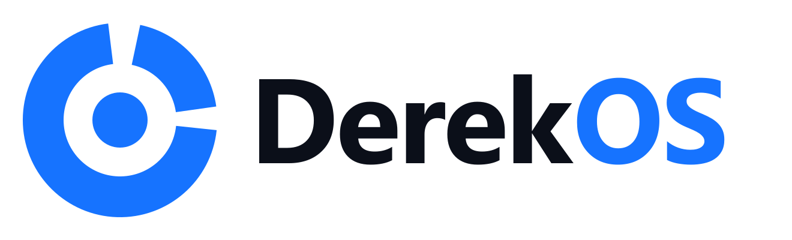

# DerekOS



Ứng dụng desktop local-first cho Windows, giúp nối việc hằng ngày với một mục tiêu dài hạn.
Dữ liệu nằm hoàn toàn trên máy bạn (SQLite), không cần tài khoản, không cần internet.

## Tải về

[](https://github.com/derekdaydoi/DerekOS/releases/latest/download/DerekOS-Setup.exe)

Link trực tiếp: [DerekOS-Setup.exe](https://github.com/derekdaydoi/DerekOS/releases/latest/download/DerekOS-Setup.exe) (Windows 10/11, 64-bit, khoảng 113 MB)

## Tính năng

- **North Star**: một mục tiêu chính, có số hiện tại, số đích và tốc độ tăng trưởng cần đạt mỗi năm.
- **Nhánh mục tiêu và mốc**: chia mục tiêu lớn thành các nhánh, mỗi nhánh gồm các mốc cụ thể (khoá học, dự án…). Xong mốc nào tick mốc đó; tiến độ bằng số mốc đã tick.
- **Theo dõi biến số**: tự định nghĩa các con số cần đo (cân nặng, thu nhập, số buổi chạy…), đặt mục tiêu, ghi giá trị theo ngày và xem biểu đồ xu hướng.
- **Nhiệm vụ**: bảng nhiệm vụ theo nhóm (quá hạn, tuần này, sắp tới, đã xong), lọc theo trạng thái và nhãn. Focus Filter giới hạn tối đa 3 việc ưu tiên mỗi ngày.
- **Lịch**: xem theo tháng, tuần hoặc cả năm; bấm vào ô ngày để thêm việc. Có nhắc việc theo giờ khi app đang mở.
- **Review tuần**: số liệu tự tính, danh sách việc chưa xong theo nhóm và ba ô tự đánh giá.
- **Thống kê**: giờ tập trung theo tuần (8 tuần, 6 tháng, 1 năm), bản đồ nhịp làm việc 16 tuần, tiến độ từng nhánh.
- **Dữ liệu**: sao lưu `.sqlite`, xuất/nhập JSON, xuất CSV nhiệm vụ.

## Cài đặt để dùng

1. Bấm nút **Tải về** ở trên để lấy `DerekOS-Setup.exe`.
2. Chạy file vừa tải. App tự cài và tạo lối tắt trên Desktop, Start Menu.

Installer chưa ký số nên
Windows SmartScreen có thể cảnh báo: chọn **More info → Run anyway**.

Lần mở đầu tiên app tạo sẵn dữ liệu mẫu (mục tiêu, nhánh, mốc, nhiệm vụ, biến số). Đây chỉ là ví dụ:
sửa trực tiếp trong app, hoặc xoá sạch tại **Cài đặt → Xoá toàn bộ dữ liệu** rồi nhập mục tiêu của bạn.

Dữ liệu lưu tại `%APPDATA%\DerekOS\derekos.sqlite`.

## Chạy từ mã nguồn

Cần Node.js 20 trở lên.

```bash
npm install
npm start        # build giao diện rồi mở app
npm run dist     # tạo installer trong release/
```

Lệnh khác: `npm run typecheck`, `npm run icon` (sinh lại bộ logo và icon).

### Lưu ý khi build trên Windows

- Đặt dự án ở đường dẫn ngắn (ví dụ `C:\dev\derekos`). Đường dẫn quá dài làm bước tạo installer NSIS lỗi.
- Nếu `npm run dist` báo `EPERM ... rename ... .tmp`, thường do antivirus đang quét thư mục vừa giải nén: chạy lại lệnh.
- Nếu `npm start` không mở cửa sổ, kiểm tra biến môi trường `ELECTRON_RUN_AS_NODE` và bỏ nó đi.

## Cấu trúc

```
electron/   main process: SQLite (sql.js), IPC, nhắc việc, cửa sổ, tự phóng giao diện theo chiều rộng
src/        giao diện React + TypeScript
  lib.ts      kiểu dữ liệu, xử lý ngày, tính tiến độ
  store.tsx   trạng thái dùng chung, đọc/ghi database
  ui.tsx      thành phần dùng lại (thẻ, modal, hình minh hoạ, logo)
  styles.css  toàn bộ style
  pages/
    Dashboard.tsx  Tổng quan, thẻ North Star
    Insight.tsx    Mục tiêu, Thống kê, Review tuần, Cài đặt
    Work.tsx       Nhiệm vụ, Lịch
    Tracking.tsx   Theo dõi biến số, biểu đồ đường
scripts/    sinh logo và icon
logo/       bộ logo (SVG, PNG)
```

Muốn đổi dữ liệu mẫu mặc định, sửa hàm `seed` trong `electron/main.cjs`.

## Công nghệ

Electron, React, TypeScript, Vite, sql.js (SQLite), electron-builder. Font: Be Vietnam Pro (đóng gói kèm, chạy offline).

Để chạy thử trên bộ dữ liệu riêng, đặt biến môi trường `DEREKOS_DATA` trỏ tới một thư mục trống trước khi mở app.
